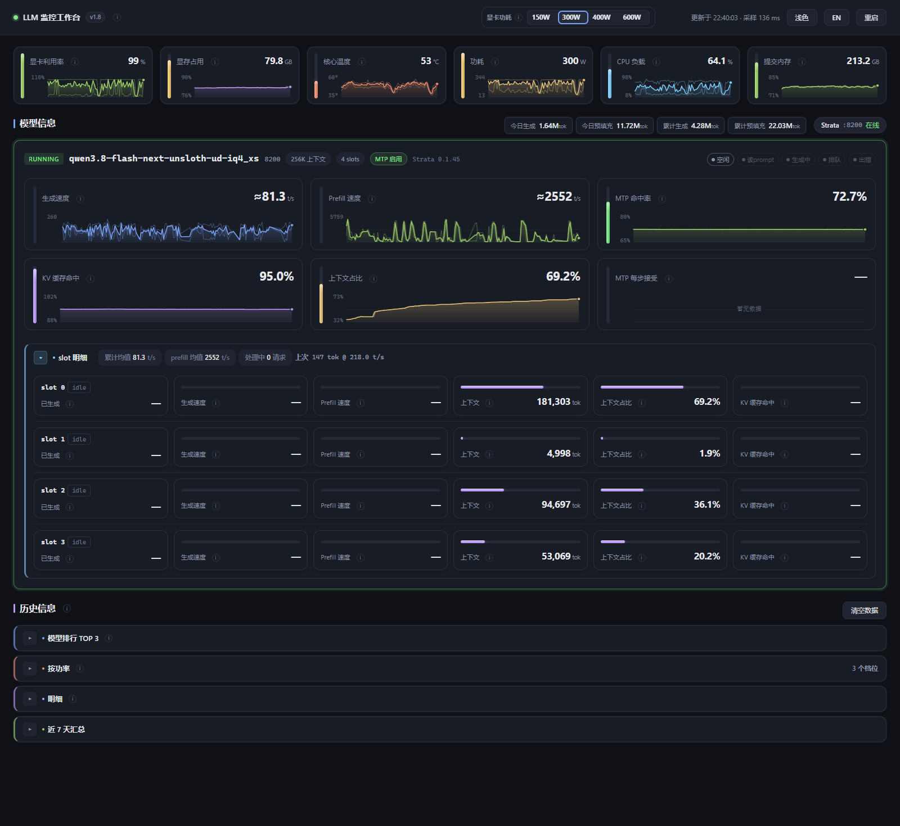
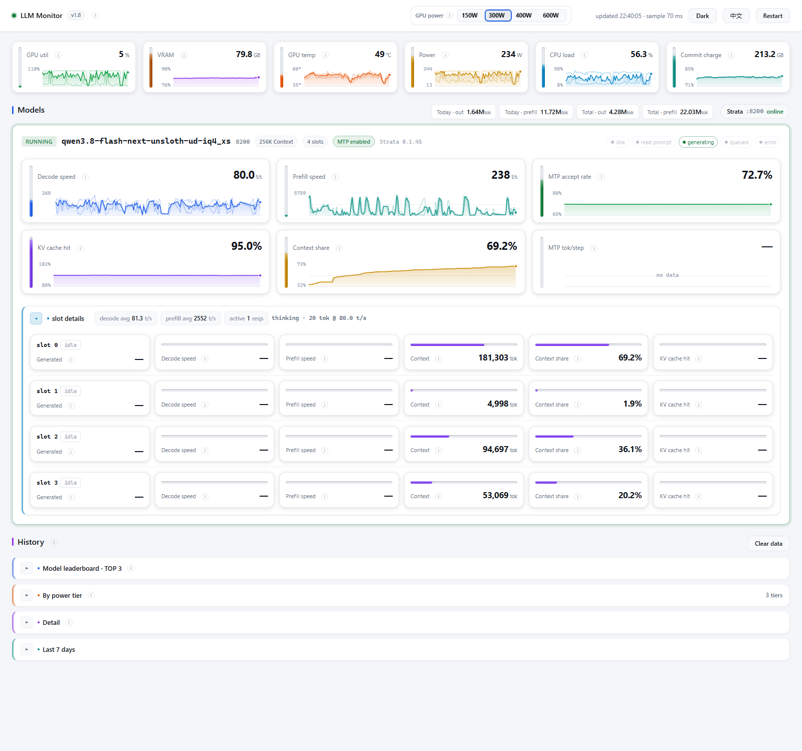

# LLM 监控工作台

**当前版本 v1.10** —— 查版本：`python monitor.py --version`，或看面板标题旁的小徽章
（它读的是服务端下发的值，不是页面里写死的）。改动历史见[版本记录](#版本记录)。

本地大模型推理 + 硬件的实时监控面板。**零第三方依赖**——只用 Python 标准库，
GPU 走 `nvidia-smi`，系统指标走 ctypes 调 Win32 API。



<details>
<summary>浅色主题 · 英文界面（顶栏 CN/EN 切换）</summary>



</details>

## 快速开始

双击桌面上的 `monitor` 快捷方式（等价于）：

```bat
wscript.exe start_monitor.vbs
```

浏览器打开 <http://127.0.0.1:8090>。

想用**功耗控制**（面板上唯一会改机器设置的控件），改用：

```bat
wscript.exe start_monitor_admin.vbs
```

它只多做一件事：弹一次 UAC 提权，然后转调 `start_monitor.vbs`。原因见
[显卡功耗控制](#显卡功耗控制)。纯看数据不需要提权。

**为什么是 VBS 而不是 bat。** 这两个脚本从 `wscript.exe`（GUI 子系统）启动，服务用
`pythonw.exe` 跑 —— 整条链上没有任何控制台。早先用 `.bat` 配 `WScript.Shell.Run(cmd, 0)`
隐藏窗口，那个窗口样式只有老的 `conhost` 认；Windows 11 默认把新控制台交给
**Windows Terminal** 托管，样式被忽略，于是双击后会留下一个关不掉的黑窗口。换成
`wscript.exe` + `pythonw.exe` 之后，没有控制台可以被接管。
副作用是输出没有地方可看：`pythonw.exe` 下 `stdout` 是空的，所以 `log()` 同时写一份
`run.log`，排查启动失败先看它。

命令行参数可覆盖配置（原样透传给 `monitor.py`）：

```bat
wscript.exe start_monitor.vbs --port 8090 --interval 2
```

**重复启动会被拒绝，并且会告诉你为什么。** 服务用 `SO_EXCLUSIVEADDRUSE` 独占端口，
第二次启动不会和已在跑的那份抢 8090。Windows 上 `http.server` 默认的 `SO_REUSEADDR`
是允许两个进程绑同一个端口的，两边都会 accept，页面就会随机读到另一个进程的数据 ——
所以这里显式关掉了。

被挡下时 `monitor.py` 会先问一句占着端口的那份是谁（读它的 `/api/snapshot`），再按结果
返回不同的退出码。启动器不等待服务（它要活到被 kill 为止），所以这些码只会写进 `run.log`，
含义是：

| 退出码 | 谁占着端口 | 含义 |
|---|---|---|
| 1 | — | 真实错误（如 `config.json` 读不了），原因已写进 `run.log` |
| 2 | **提权**的面板 | 那份已经能改功耗，不需要第二份 |
| 3 | **只读**的面板 | 那份只能看；接管要先 `taskkill`，命令写在 `run.log` 里 |
| 4 | 不是面板的其他进程 | 端口上是别的东西，浏览器不会被打开 |

启动器自己也不靠退出码决策：它先用一次 HTTP 探测（走 `WinHttp`，不经过系统代理）判断面板
是否已经在跑，在跑就直接开浏览器。所以双击快捷方式而面板其实已经在跑时，你看到的是浏览器里
那个面板，而不是一句报错。只想确认状态、不想开浏览器的话，直接跑 `python monitor.py` 读退出码。

## 界面

- **曲线可悬停取值**：鼠标移到任意迷你图上会出十字线，并显示该处的数值。
- **每张卡片右侧的 ⓘ** 是该项口径说明（分母是什么、阈值多少、什么时候会变红）。
- 卡片脚注写的是**带标签**的数字，例如"上限 262,144 tok · 空闲残留"，不出现孤零零的比值。
- `warn` / `fail` 级别的结论（温度偏高、接近上限、采集失败）直接写在卡片脚注或端点上，
  不藏进 ⓘ。
- 深浅色跟随系统（`prefers-color-scheme`），也可以手动切换，选择记在 localStorage。
- 页脚会显示曲线历史点数与覆盖时长。
- **顶栏那个小圆点表示数据通道，不是被监控的端点**（端点状态在各自的卡片上）。三态：
  绿 = 实时推送中；黄 = 推送不可用、已降级为**定时轮询**；红 = 断开、正在重连。
  鼠标悬停有文字说明。

### 自动刷新是怎么保证的

两条独立通道，谁能用谁上：

1. **SSE**（`GET /api/stream`）—— 正常情况。每个采样周期推一帧，立刻渲染。
2. **看门狗轮询** —— 如果连续 8 秒没收到任何帧，自动改用 `GET /api/snapshot` 每 4 秒拉一次。
   一些内嵌浏览器和预览面板会直接屏蔽 `EventSource`，这种情况下只靠 SSE 就等于**页面永远
   停在打开那一刻** —— 而"你自己刷新一下"不是个答案。

推送恢复后轮询会自己停（两者用独立时间戳，流一旦有帧就不再轮询），不需要手动切回。

**每帧都带完整快照**，不只是扁平化的标量序列。卡片读的是快照，所以只带序列的帧会让
**曲线继续走、所有数字冻住** —— 这个 bug 真出现过一次，`tools/render_check.js` 现在会
同时检查帧契约和"推一帧后数字是否真的变了"。

## 监控什么

Hermes 桌面端在会话里切换模型时，不一定修改全局默认配置。monitor 每约 2 秒
只读 `state.db` 中最近活动、未结束且未归档的桌面会话路由，优先跟随它的本地服务；
会话只记录模型名而没有服务地址时，先核对 monitor 已配置的 router 是否加载了该模型，
然后才回退到 `config.yaml` 和端点配置。多个会话并存时
按最近活动时间选择，不判断前台标签页。其他仍加载着模型的服务继续展示，但只有
被跟随的来源标为 `running`；与已有端点地址相同时仍合并为一张卡。

**推理**（来源：llama-server 的 `/metrics`、`/slots`、`/props`）

| 指标 | 口径 |
|---|---|
| 生成速度 | Δ`tokens_predicted_total` ÷ Δ`tokens_predicted_seconds_total`（瞬时），另附 counter 累计均值 |
| Prefill 速度 | Δ`prompt_tokens_total` ÷ Δ`prompt_seconds_total` |
| MTP 命中率 | `spec_decode_num_accepted_tokens_total` ÷ `spec_decode_num_draft_tokens_total` |
| MTP 每步接受 | accepted ÷ `spec_decode_num_drafts_total` |
| MTP 逐位置命中 | `..._accepted_tokens_per_pos_total{position=N}` ÷ 验证步数 |
| MTP 是否启用 | preset 启动参数里的 `--spec-type` —— **不是** `/props` 的 `speculative.types` |
| KV 缓存命中 | `prompt_tokens_cached_total` ÷ (cached + 新建) |
| 上下文占比 | `/slots` 的 `n_prompt_tokens + n_decoded` ÷ `/props` 的 `n_ctx` |

**`speculative.types` 不可信**：MTP 用 `--spec-type draft-mtp` 跑起来时，`/props` 里这个字段
照样报 `none`，slot 里也可能不带这个键。所以卡片上的 MTP 标签取自 `/v1/models` 回传的 preset
启动参数。本机实测 6 个 preset 里只有 `Qwen3.6-35B-A3B-UD-Q4_K_M` 与 `Qwen3.8-27B-UD-Q4_K_M`
真的开了 MTP，其余 4 个没有 —— 光看 `/props` 会把它们全判成同一档。

**上下文占比的"空闲残留"**：请求结束后服务端会清掉 slot 的提示词计数（`n_prompt_tokens`
变成 `null`），此时分子只剩 `next_token[].n_decoded`。卡片会标出"空闲残留"，避免把这个
残值当成实时占比。

**显卡**：利用率、显存占用与带宽、温度、功耗（含上限）、风扇、SM/显存频率、PCIe 链路、计算进程归属。

**系统**：CPU 总负载、每核频率、物理内存、提交内存（commit charge）、系统缓存、句柄/进程/线程数、固定分区容量、`llama-server` 进程的 host 内存占用。

## 显卡功耗控制

显卡区下方的档位条对应 `nvidia-smi -pl`，也就是显卡的功率墙。满载时 GPU 会在这个上限
附近降频，功耗不会超过去。

**档位跟着显卡走，不是写死的。** 菜单在运行时按显卡自己上报的 `power.min_limit` /
`power.max_limit` 推导：

- 窗口能覆盖 600 W 级的卡（最大上限 ≥ 575 W）用实测标定过的那一套
  **150 / 300 / 400 / 600 W**（静音 / 低耗 / 均衡 / 复原）。400 W 是 150–600 W 功耗曲线的
  能效顶点：曲线在 450 W 之后变平，那里是 ~95% 峰值速度下最好的 t/s-per-watt。见 `power_curve/`。
- 其它任何卡按自己最大上限的 **40 / 60 / 80 / 100 %** 生成四档，取整到 5 W。比如
  RTX 5090 Laptop（5–175 W）得到 70 / 105 / 140 / 175 W；一台 300 W 的桌面卡得到
  120 / 180 / 240 / 300 W。

菜单只在一个地方生成（`collectors/power.py` 的 `presets_for()`），写接口做白名单校验时用的
就是下发给面板的同一份列表，所以"面板上有的按钮"和"接口肯接受的值"不可能各走各的。前端的中文
档位名按**角色**映射（静音/低耗/均衡/满血），与瓦数解耦；600 W 级卡上标定出来的实测数字，只在
菜单确实来自那份标定表时才附加显示。

**笔记本 GPU 接受不了这个设置，而且拒绝方式很阴。** 这不是权限问题：驱动对 `nvidia-smi -pl`
直接回 `Changing power management limit is not supported in current scope`，**退出码却仍然是
0**，还照样打印 "All done."。所以本工作台不看退出码，而是解析驱动自己的输出；识破后回
`unsupported`，面板随即撤掉档位按钮并改报实测上限。笔记本的上限由 Dynamic Boost 在出厂 TGP
区间内自主调整（5090 Laptop 实测在 110–175 W 之间浮动），要改只能走厂商控制中心或 NVIDIA
控制面板里的性能模式，`nvidia-smi` 这条路是关着的。

**两条功耗读数不是一回事。** `power.limit` 是**软件功耗墙**，即 `-pl` 写进去的那个值；笔记本
GPU 根本不报这一列（永远 `[N/A]`）。`enforced.power.limit` 是**驱动此刻真正在生效的上限**，
任何卡都报，且在笔记本上会随 CPU 负载与温度浮动。面板优先用软件墙做分母；没有软件墙时改用生效
上限，并在读数后面标「动态」，同时把 `出厂默认` 一并显示出来当参照。功耗卡和档位条用的是同一
套回退规则，所以两处的"上限"永远指同一个数。

**需要管理员权限。** 这不是本工作台加的限制 —— Windows 上非管理员执行 `nvidia-smi -pl`
会被直接拒绝，退出码 5（`ERROR_ACCESS_DENIED`），改动根本不会发生。本机实测过：用受限令牌
（`runas /trustlevel:0x20000`）运行时，连 `--query-gpu` 都返回"拒绝访问"。所以
`monitor.py` 启动时会做一次权限自检并把结论写进 `run.log`；面板上无权限时档位条是禁用的，
并且直接写明该改用哪个脚本启动。

**重启电脑后恢复默认。** nvidia-smi 的设置不持久。要开机自动应用，用任务计划程序
（勾选"使用最高权限运行"）跑一个 `nvidia-smi -pl 450`。

**能省多少、会慢多少。** 出字（decode）阶段卡在显存带宽，限功耗主要砍的是 SM 算力，
所以适度下调通常几乎不掉速；预填充（prefill）阶段卡在算力，会实打实变慢，但它只占一次
请求开头的一小段。有个可对照的社区实测：RTX 5060 Ti 从 180 W 降到 150 W 底线，吞吐只从
81.2 掉到 80.4 tok/s。**但这个比例不能直接套用** —— 那是把 180 W 卡降到 83%，而 150 W
只有本机型 600 W 的 25%，降这么狠会开始碰到真实瓶颈。

**只接受预设档位。** 接口用白名单校验（就是下发给面板的那份菜单），且写入前会读一次显卡报告
的 `power.min_limit` / `power.max_limit`，超出范围直接拒绝，而不是交给驱动去静默钳制。

**写完必须回读，且回读方式分两种。** 驱动可以拒绝或取整，档位高亮也以实测值为准 —— 万一别处
改了功耗，按钮跟着现实走，而不是跟着"我上次请求了什么"。驱动肯报软件墙时直接比对；不肯报时
（笔记本）退一步拿生效上限做旁证 —— 功耗管理算法永远不会把上限抬到软件墙之上，所以"上限明显
高于刚请求的值"就说明这次写入没落地，那种情况回 `not_applied`，而不是报成功。两条路都读不到
时回 `verified: false`，面板把话术改成"已下达 X W（驱动不回读）"，不假装确认过。

### 这个写接口是怎么防跨站的

`POST /api/power-limit` 是这个服务上唯一的写操作，而浏览器里任何页面都能向
`127.0.0.1:8090` 发请求。三层校验：

1. **Host 必须是回环地址** —— 挡 DNS rebinding（攻击者域名解析到 127.0.0.1，浏览器就会
   把它当成同源）。
2. **Origin 存在时必须是回环** —— 挡跨站表单提交。
3. **必须带自定义头 `X-LLM-Monitor: 1`** —— 这层才真正起作用：自定义头会强制 CORS 预检，
   而服务端从不响应 `OPTIONS`，跨站脚本连请求都发不出来。普通表单能过前两层，但设不了
   自定义头。

三条路径实测分别返回 `403 bad_host` / `403 bad_origin` / `403 missing_header`。

## 历史信息（Token 账本）

推理区下方是一份跨重启的 token 用量账本，回答三个问题：**今天用了多少**、**一共用了多少**、
以及**这些量是在显卡哪个功率档下跑出来的**。

**为什么非要一个账本。** llama-server 只把 token 数报成**进程生命周期内的累计值**
（`prompt_tokens_total` / `tokens_predicted_total`），server 一重启、或者 router 卸载了模型，
这些数就回到 0。面板自己也不留历史 —— 曲线缓冲只有 900 点（默认约 30 分钟）且全在内存里。
所以直接读 counter 只能回答"这个 server 进程起来之后用了多少"。

**怎么算的。** 每轮采样读一次原始 counter，与上次的值相减得到增量，累加进 `stats.json`。
关键在于**文件里同时存着上一次读到的原始计数值**：面板重启后拿它当基线继续减，于是既不会
丢掉停机期间产生的量，也不会把 server 的历史总量重复计一遍。counter 变小说明 server 重启过
（或模型被卸载），此时从 0 重新起算，并记一次"归零"。

| 数字 | 口径 |
|---|---|
| 今日生成 | `tokens_predicted_total` 的当日增量 |
| 今日预填充 | `prompt_tokens_total` 的当日增量（**只含实际参与计算的**） |
| 累计生成 / 累计预填充 | 同上，跨日累加 |
| KV 复用（副行） | `prompt_tokens_cached_total` 的增量，即走缓存没有重算的那部分 |

预填充与 KV 复用是**互斥的两部分**：前者真的跑了前向，后者直接从 KV 缓存拿。所以"输入总量"
是两者之和，卡片上的"今日预填充"只统计前者 —— 本机实测过 cached 比 prompt 还大的情况。

### 三个下钻维度

同一份增量会同时记进三个不同切分方式的桶，所以每笔量都能被追问下去：

| 区块 | 切分 | 回答的问题 |
|---|---|---|
| 近 7 天汇总 | 日期 | 哪天跑了多少 |
| 按功率档归集 | 显卡功耗上限 | 这些量是在哪一档功耗墙下跑出来的 |
| 明细 | 日期 × 功率档 × 模型 | 某天、某档位、某个模型各跑了多少、多快 |

**速度**用的是引擎自己上报的耗时（`prompt_seconds_total` / `tokens_predicted_seconds_total`），
不是墙钟。这两个计数器只在引擎真正计算时增长，所以空闲时间不会把速率摊薄 —— 它反映的是
"干活时有多快"，和面板上那两张速度卡是同一套口径。**预填充速率的分子含 KV 缓存命中的 token**，
而缓存重读几乎不费时间，所以命中率越高这个数越大；对着明细表里的"KV 复用"一列看就能判断出来。
某个组合的耗时计数为 0 时显示 `—`，不假装是 0 t/s。

**功率档是按时间归因，不是按用量分摊。** 功耗上限属于整张显卡，同一张卡上同时跑的几个模型
都会被记进同一个档位，所以这个数永远不代表"某个模型耗了多少瓦"。它只说明"产生这些 token 的
那一刻，卡被限在多少瓦"。档位归集从**本功能启用那一刻**开始记，之前的 token 没有记录当时的
档位，所以各档之和小于累计总量 —— 页面上有一条说明直接写着起始时刻。采样时读不到功耗上限
（显卡采集关闭或驱动查询失败）会单独记成"档位未知"并显示为警告，不会被并进任何一档。

**档位记的是"当时生效的那个值"。** 优先软件功耗墙（就是你点的那一档）；笔记本这类不报软件墙的
卡退回到驱动的生效上限，并**取整到 5 W** —— 那个上限每秒都在动，逐瓦记一档只会把账本打碎成
一堆没有意义的行。取整得来的档位在面板上显示成 `≈170 W`，一眼能看出它不是从菜单里选的；
`175 W 满血` 这种才是。档位行数有上限（`TIER_CAP`），超出后按量级保留前面几档。

**落盘。** `stats.json` 与面板同目录，写入先落 `.tmp` 再改名，中途崩溃不会留下半个文件。
数据有变化时每 15 秒写一次，Ctrl-C 退出时补一次。文件损坏不影响启动，只是降级成"只在内存里
记账"，页面上会直接显示一条黄色提示（这类结论不进 hover）。

**清空。** 「历史信息」标题栏的「清空数据」把上面这些桶整体归零：两次确认（第一次数清楚会掉什么，第二次写明不可撤销），当场写回 `stats.json`；它**不清原始计数基线**，所以清空之后不会把 server 进程的历史累计重新入账，新的一格从当下这一刻开始记。曲线历史不在清空范围内 —— 那本来就只有约 30 分钟。

**边界**：面板停机期间如果 server 也重启过，那段时间的量会归到重启后的计数上，无法精确切分。
另外首次见到某个模型时，会把它当时已有的累计值整体计入 —— 否则那部分就永久丢了。
但**"这个模型没见过的某个字段"不走这条规则**：那种情况只把当前值当基线、不计入任何量。这条
区别很关键 —— 加 `*_seconds` 那次忘了区分，结果给已在跟的模型记进了几分钟的耗时却对应 0 个
token，所有速率都算成了"没有数据"。旧版 `stats.json`（v1，没有档位与明细）能直接读，只是
新的两个维度从升级那一刻开始重新累计。

## 配置

`config.json` **不在仓库里** —— `.gitignore` 把 `*.json` 一并排掉了，因为它按机器而定。直接跑
`monitor.py` 会顺手生成一份默认配置，但默认配置里 `api_key` 是空的，而 hermes 每次启动都会换
一个新 key，于是面板会以 401 开场、一个模型都不显示（报错只说 `unauthorized`，看不出是配置问题）。
正常启动路径不用管这件事：`start_monitor.vbs` 会先跑一次 `tools/sync_hermes_key.py`，把 router
当前的 key 与日志路径抄进 `config.json`。手动修也行：

```bash
python tools/sync_hermes_key.py          # 同步 port / api-key / live.log
python tools/sync_hermes_key.py --check  # 只报告差异，不动文件
```

它幂等且克制：key 没变就不写文件，找不到 router 日志就不碰配置（面板照旧报 401，不会更糟）。

编辑 `config.json`：

```json
{
  "server": { "host": "127.0.0.1", "port": 8090, "interval_seconds": 2.0 },
  "endpoints": [
    {
      "id": "hermes",
      "label": "Hermes Router",
      "base_url": "http://127.0.0.1:18434",
      "api_key": "...",
      "api_key_env": "HERMES_LLAMA_API_KEY"
    }
  ],
  "stats": { "enabled": true, "path": "stats.json", "keep_days": 90 },
  "live": { "enabled": true, "log": "D:/AI/hermes/logs/llama-server.log" }
}
```

- `api_key_env` 里的环境变量**优先于** `api_key` 字段。不想把密钥留在文件里就设它。
- `live.log` 是 router 的启动日志。`live` 端点**优先直接问 router 的 `/v1/models`** 判断当前
  模型，日志只是兜底；但日志路径还兼一个用途 —— 从它反推出 hermes 的 `config.yaml` 在哪，
  端点地址就从那份配置里读。**一般不用手填**：启动时 `tools/sync_hermes_key.py` 会探测并写回。
  候选是 `%LOCALAPPDATA%\hermes\logs\llama-server.log` 与 `D:\AI\hermes\logs\llama-server.log`，
  取存在的里面最新的一个；显式配了 `live.log` 且文件在，就以它为准。真配错了也不会只剩一句报错
  —— 卡片上会直接写出它找过的位置。
- 端点可以配多个，router 模式和单模型模式会自动识别。
- `kind` 声明这个端点说的是哪种方言。**不写就是 `llama`**（Prometheus 文本 `/metrics`），
  `"kind": "strata"` 表示 Strata 服务（JSON `/metrics`）。方言是服务端的属性，所以配在配置里
  而不是靠探测 —— 探测要在每次启动时都跑一遍（包括那个服务没起的启动），而且对"长得像
  llama.cpp 但不是"的服务照样会猜错。写错的 `kind` 会在启动日志里点出来并退回 `llama`。

```json
{ "id": "strata", "label": "Strata", "kind": "strata", "base_url": "http://127.0.0.1:47831/v1" }
```

（写 app 给自己的那个客户端 URL 就行，见下一节；采集器要的是服务根地址，尾巴上的
`/v1` 会被吃掉。）

- 服务未启动的端点不会拖慢采样，只是显示为离线。
- `stats.enabled` 设成 `false` 就关掉 token 账本（既不读也不写）；`stats.path` 的相对路径按项目
  根目录解析，父目录不存在会自动创建；`stats.keep_days` 控制每日明细的保留天数，超期的"日桶"
  会被丢掉，但累计总量不受影响。能耗面板（v1.10）共用这套账本：`stats.enabled: false` 时它同样
  没有数据。估算模型（平台瓦、CPU 线性模型、电源效率、电价）是 `collectors/stats.py` 顶部的常量，
  随 `/api/snapshot` 的 `stats.energy_model` 下发给页面 —— 改常量就是改账本和显示的共同口径。

### 怎么拿到 hermes 当前的端口和密钥

两件事分开看：

**端口（端点地址）不用管。** hermes 每次启动都会换一个端口，并把结果写回自己的
`config.yaml`（`model.base_url`）。面板以那一刻的 `config.yaml` 为准，并且**每 15 秒重读一次**，
所以 hermes 重启后地址变了会自动跟上；上一次采样发现 router 没应答时更会**立刻重读**，不等
这 15 秒。`config.json` 里的 `base_url` 只是兜底（机器上没有 `config.yaml` 时用）。哪个文件被
采纳写在启动日志的 `hermes router:` 那行；地址真的变了会另起一行 `hermes router moved:`。

**密钥仍以启动日志为准。** api-key 不写在 `config.yaml` 里，只在日志的 `# spawn: [...]` 行：

```bash
grep -- "--api-key" "D:/AI/hermes/logs/llama-server.log" | tail -1
```

这行同时给出 `--port` 和 `--api-key`。同步这件事已由 `tools/sync_hermes_key.py` 自动完成，
上面这行只在排查时用得上。注意**端口跟着 `config.yaml`、密钥跟着日志**：拿它手工对配置时别把
两者混在一起用。

### 让面板跟上 Strata 桌面版的端口和密钥

Strata 桌面版**不是引擎**：它是一个"网页 UI + OpenAI 兼容代理"，真正跑模型的是它自己拉起来的
`serve/server.py` 子进程，而且**每加载一次模型就换一个新端口、配一把新 api-key**。地址写死成
上一次那个，面板就只有两种坏法：端口空着（`connection refused`），或者端口被那个 app 占着 ——
app 把不认识的 URL 一律当前端路由，`/props`、`/metrics`、`/slots` 全回一段 HTML，于是报错长成
`Expecting value: line 1 column 1`，看着完全像 key 配错了。

所以 `kind: strata` 的端点自己去找引擎，按三档来：

1. **配的地址本身就是引擎**（`/health` 回 `service: strata`）。手起的 `serve/server.py` 走这档：
   配置说了算，绝不被机器上另一份记录拽走。
2. **配的地址是 app**：问它 `/v1/models`（app 唯一会正经回 JSON 的那个接口），用响应里的
   `meta.instanceId` 去开 `%USERPROFILE%\.strata\data\native-instances\<id>.json` —— 那份文件正是
   app 自己交给 `serve.server --config` 的启动记录，`host` / `port` / `api_key` 与启动参数都在里面。
   app 说哪个引擎在服务就跟着哪个，**哪怕它还在加载模型**（卡片老实写"还没应答"），不去抢旁边那台
   活着但无关的进程。
3. **连 app 的地址都过期了**（app 重启过、`config.json` 没跟上）：取**最新且 `/health` 应答**的记录，
   最多试 3 份（每份一次健康检查，Windows 上打空一个死端口要两秒）。一档都没应答就原地不动，
   保留原地址报它真实的错误 —— 比报一个"背后什么都没有"的端口更诚实。

于是 `config.json` 里这条端点写 app 给用户的那个 URL 最省事，端口漂移由采集器负责：

- 跟到了哪台引擎、凭什么跟，随采样帧带在 `follow_reason` 字段里（页面暂未渲染）；换端口会在
  `run.log` 落一行 `strata moved: <旧> -> <新> (<理由>)`，与 `hermes router moved:` 对称。
- 频率：引擎在线时每 15 秒复查一次，查不到时每 5 秒一次。每次最多三个请求，不会拖垮采样周期。
- `"discover": false` 关掉整套（引擎在别的机器上、或这个进程读不到那个目录）；`"instance_dir"`
  指定别处的记录目录，环境变量 `STRATA_INSTANCE_DIR` 同义且优先。
- 读的是**运行面板的这个用户自己的** `~\.strata` —— 那本来就是 app 存自己密钥的地方，不是从别人
  机器上抄 key。配置里的 `api_key` / `api_key_env` 只在第 1 档还有意义。
- 卡片指向 app 时，它**代表**的是 app 那个地址（`proxied_url`）、**轮询**的却是引擎地址。看板去重
  认的是"代表"的那个，否则 Hermes 跟着 app 的 URL 时会多出一张卡，账本也会把同一批 token 记两遍
  （见「一张卡，一份账」）。
- **key 也跟着记录走。** 引擎的 `/health` 是公开的，它回 `"api_key": true` 恰恰说明其余接口
  （`/props`、`/metrics`、`/v1/models`）不是 —— 所以"端口找对了、key 没带上"是第三种坏法：卡片
  `up=True`、模型名和上下文窗口都对，每一个数都是空，跟方言错那张空卡一模一样，只是报错换成 401。
  两处补：第 1 档认出引擎时，若它说自己锁着计数器而配置里没有 key，就从同一地址的记录里读 key
  （不额外发请求）；轮询返回 401 时再读一次记录并重试，恢复在同一帧完成，而不是让卡片空 15 个
  周期。没有对应记录时不猜 key，卡片照实报"unauthorized"。

### 让 llamacpp-loader 也能被监控

loader 起的 server 默认**不带** `/metrics` 端点，需要在 GUI 的 **Advanced** 页把
**Metrics** 打开（对应启动参数 `--metrics`）。`/slots` 是 llama.cpp 默认开启的，无需设置。

## 实现上的几个坑

1. **router 模式下 `/metrics`、`/slots`、`/props` 必须带 `?model=<id>&autoload=false`**，
   否则一律返回 400。本工作台会先从 `/v1/models` 挑出 `status.value == "loaded"` 的模型，
   再逐个带上参数去拉。
2. **`llamacpp:predicted_tokens_seconds` 这个 gauge 在空闲时读 0**，直接显示会把"空闲"
   误报成"卡死"。所以速率一律由 counter 差分算出。
3. **`urllib` 在 Windows 会读取 `http_proxy` 环境变量**，导致请求 `127.0.0.1` 被送到代理上
   而失败。采集器显式使用了空的 `ProxyHandler`。
4. **`nvidia-smi -pl` 有三种失败方式，退出码只认得出第一种**：非管理员下退出码 5、输出"拒绝
   访问"；笔记本上输出 `Changing power management limit is not supported in current scope`
   而**退出码是 0**，只看返回码就会以为改成功了；还有第三种 —— 命令被接受、值根本没变。所以
   写完一律回读：驱动肯报 `power.limit` 就直接比对，不肯报（笔记本）就拿 `enforced.power.limit`
   当旁证（功耗管理算法不会把上限抬到软件墙之上），两条都读不到就明说"验证不了"。档位高亮同样
   以实测值为准 —— 万一别处改了功耗，按钮跟着现实走，而不是跟着"我上次请求了什么"。
5. **推送的帧内容是一份契约，两边必须同时改**。`hub.broadcast()` 原来只发
   `{point: {ts, values}}`，而卡片渲染读的是 `S.snapshot` —— 于是曲线照常延伸、**所有数字
   停在建连那一刻**，看起来就像"页面不自动刷新"。首帧是好的（它带 snapshot），所以只打开
   页面看一眼完全看不出问题。改法：每帧都带 `{snapshot, point}`。
6. **jsdom 里加了 `setInterval` 之后，node 不会自己退出**。烟测新加的看门狗让事件循环永远
   不空，脚本一直挂到被 SIGTERM 杀掉，于是**真实退出码被 SIGTERM 顶替**，看起来像失败了。
   所以报告写完要显式 `process.exit(code)`（用回调形式，先冲 stdout）。
7. **`config.json` 不进仓库，而它的默认值原本是按开发机写死的**：`api_key` 空着，`live.log`
   指向 `D:/AI/hermes/logs/llama-server.log`。新克隆的副本于是"两个端点都读不到模型"，而页面
   上的报错都看不出问题出在配置上。这个默认值后来改成从 `%LOCALAPPDATA%` 推导 —— **单一路径的
   猜法本身就不可靠**：`%LOCALAPPDATA%` 在任何 Windows 上都有，Hermes 却不一定往里写东西，
   猜错的后果又只是"卡片空白"。现在改成候选列表 + 最新者优先（见 v1.2），key 由
   `tools/sync_hermes_key.py` 在每次启动前同步。
 8. **`for /f` 的命令集里再嵌一层引号，cmd 会解析错**：启动脚本原本用它探测端口，于是每次启动
    都先打印一行 `'C:\...\python.exe" -c "..."' is not recognized`（探测因此永远失败）。
    直接调用、看退出码就够了。
 9. **"端点在线"不等于"取到了数"**：采集器的每一种失败都会变成 `null`，而 `null` 在页面上和
    "服务空闲"长得一样。Strata 那次就是这样 —— `up=True`、模型名、上下文窗口全对，
    `/metrics` 却是 JSON，所有的 counter 都解析成 `None`，**整张模型卡空白而没有任何报错**。
    所以"数不对"要先看**协议**（是不是这种方言），再看字段名。同理，端点的自报状态只说明它答话了。
 10. **"只渲染第一个有模型的端点"是个会过期的假设**：前端曾按 `find` 取第一个有模型的端点渲染
     整个"模型信息"区。"同一时刻只有一台在服务"时它成立；hermes 与 Strata 同时在线后，第二台
     只剩一枚"在线"角标，模型名、速率、上下文在页面上**完全不存在**，而页面看起来一切正常。
     多服务并存时，每个有模型的来源都要有自己的卡（见 v1.2）。

## 目录结构

```
llm-monitor/
├── monitor.py                 # HTTP 服务 + SSE 推送 + 历史环形缓冲 + 写接口
├── collectors/
│   ├── llama.py               # llama.cpp 指标（router / 单模型自适应）
│   ├── hermes_live.py         # 「当前模型」跟随：读 router 的 /v1/models 与 spawn 日志
│   ├── hermes_session.py      # 当前会话所属 provider 的判定（决定跟随哪台）
│   ├── strata.py              # Strata 的 JSON /metrics 方言 → 同一套 counter 名字
│   ├── gpu.py                 # nvidia-smi 解析 + 显存归属
│   ├── power.py               # 功耗上限读写 + 按卡推导档位菜单（服务上唯一的写操作）
│   ├── stats.py               # token 账本：counter 折叠 + 原子落盘
│   └── system.py              # Win32 ctypes 采集
├── frontend/
│   ├── index.html
│   ├── app.js                 # 渲染 + Canvas 迷你曲线 + 功耗档位控制（只渲染中文）
│   ├── i18n.js                # CN/EN 切换：词典 + MutationObserver 翻译层
│   └── style.css              # 深浅双主题
├── tools/
│   ├── render_check.js         # 无浏览器的渲染烟测（见下）
│   ├── benchmark_spark_fill.js # 曲线下方填充的可复现度量（新旧实现同口径对照，见下）
│   ├── verify_slot_note.py     # CDP 驱动本机 Chrome + 真发流量，核验逐槽状态与它的解释
│   ├── ledger_check.py         # token 账本的折叠规则自检（见下）
│   ├── sync_hermes_key.py      # 把 router 当前的 port / api-key 抄进 config.json
│   └── make_icon.py            # 生成 assets/ 里的 ico（make_launcher_icons.py 是批量版）
├── tests/                     # unittest，标准库即可跑（见下）
├── assets/                    # 面板 / 启动器的图标
├── docs/                      # README 用的截图
├── config.json                # 端点与 API key（首次启动自动生成，不进仓库）
├── stats.json                 # token 账本数据（自动生成）
├── run.log                    # 启动与运行日志（自动生成；pythonw 下唯一可读的输出）
├── package.json               # 只有 render_check 的 devDependency（jsdom）
├── start_monitor.vbs          # 普通启动（功耗控制只读）
└── start_monitor_admin.vbs    # 提权启动（解锁功耗控制）
```

### 渲染烟测

前端没有浏览器也能验证：`tools/render_check.js` 用 jsdom 把 `index.html` + `app.js` 跑起来，
喂进真实的 `/api/snapshot` 数据（canvas 用桩替代，CSS 变量从 `style.css` 里解析出来），
然后打印每张卡的标签/数值/脚注、模型标签与明细、表格行数，以及有没有抛异常。
静态检查抓不到"渲染到一半抛错导致白屏"，这个可以。

它同时覆盖两条**不抛异常、但页面就是没用**的失败路径 —— 这两种才是用户真正会发现的：

- **帧契约**：真的连一次 `/api/stream`，确认第 2 帧（稳态帧）里既带 `snapshot` 也带 `point`。
  缺 `snapshot` 就意味着数字会冻住、只有曲线在动。
- **推帧后数字是否真的变了**：推一帧与真实数据不冲突的样本，对比推帧前后 `#gpu` / `#host`
  每张卡的数值；曲线点数还应该 +1（那是 `point` 那条路径）。

它也会检查 **Token 账本**：推帧后账本数字必须跟着变（它同样是只读面板，同样吃帧契约），
并且把 `stats.available` 置为 false 时页面要显示"未启用"，而不是留白或沿用上一帧的旧数。

```bash
npm install                  # 依赖清单在仓库里（package.json / package-lock.json）
node tools/render_check.js http://127.0.0.1:8090   # 或 npm run render-check
```

退出码非 0 = 有未捕获错误，或上面任意一条不成立。**改前端必跑。**

### 账本自检

`tools/ledger_check.py` 直接测 `collectors/stats.py` 的折叠规则，不起服务、不发请求。
账本唯一的职责就是判断"这次读数里有多少是新的"，规则错了页面上只会显示一个看起来很合理的
数字，所以每条规则都单独特判 —— 包括跨重启续算、counter 回退、模型中途上线不算回退、
损坏文件降级、只读路径降级这些手工很难复现的情况。

```bash
python tools/ledger_check.py
```

### 单元测试

`tests/` 用的是标准库 `unittest` —— 不需要 pytest，也不需要装任何依赖：

```bash
python -m unittest discover -s tests
```

覆盖两处"规则错了也照样出数、只是数字不对"的地方：`hermes_session.py` 的 provider 判定
（同名的远端模型不能被接到本机 router 上）、`strata.py` 的逐槽读数与曲线键（键跟 slot id 走，
不跟它在列表里的位置走，否则并发时曲线会串槽）。

HTTP 接口：

| 方法 | 路径 | 说明 |
|---|---|---|
| GET | `/` | 面板页面 |
| GET | `/api/snapshot` | 当前采样 + 历史序列 + 配置（含 `version`、`elevated`、按卡推导的 `power_presets`、`power_settable`） |
| GET | `/api/stream` | SSE，每个采样周期推一帧 `{snapshot, point}`（见「自动刷新是怎么保证的」） |
| POST | `/api/power-limit` | 设置功耗档位，body `{"watts": 140}`（值必须是当前菜单里的一档），需 `X-LLM-Monitor: 1` 头 |
| POST | `/api/restart` | 让面板进程自己重启（同一道写 guard，见 v1.5） |
| POST | `/api/stats-reset` | 清空 token 账本的桶、保留引擎计数基线（同一道写 guard，见 v1.7） |

历史保留 900 个采样点（默认 2 秒间隔约 30 分钟），刷新页面不会丢曲线。

## 已知限制

- 系统指标依赖 Win32 API，非 Windows 平台只会返回 `system collector supports Windows only`。
- **WDDM 驱动下 nvidia-smi 不提供每进程显存**，所以进程表里 `llama-server` 的显存常显示
  `N/A`。这里只保留有数据的行和推理进程，避免被一堆桌面进程刷屏。
- CPU 为总负载，不是每核负载（每核利用率需要 PDH 性能计数器，尚未接入）；每核频率是可用的。
- 网络吞吐尚未采集。
- **Strata 卡片能跟着引擎跑，但只认它自己那台 app。** 第 3 档兜底（app 的 URL 也过期）靠的是记录目录
  里"最新且应答"的那份，它答不出 app 现在的新地址；此时 Hermes 若正跟着那个新地址，会多出一张
  跟随卡报"answered something other than JSON"。把手上这张卡的 `base_url` 改成 app 的新地址（或干脆
  改成引擎地址）即可，`run.log` 里 `strata moved:` 那行就写着该填哪个。
- **曲线是手写 canvas，不是图表库**：900 个采样点会先按约 2px 一列分桶并保留每列的极值，
  画成"曲线 + 曲线下方渐变填充 + 包络线"。直接逐点连线在 200px 宽的卡片里会糊成毛线，
  而且尖峰会被磨平。
  **填充必须是曲线下方的面积，不能只是包络带**：包络带在接近水平的序列上只有几个像素厚，
  看起来就是"一根孤零零的线"（这是用户报的现象）。现在每张有数据的卡都从曲线填到基线，
  用该卡自己的颜色做纵向渐变（曲线处 0.30 → 基线处 0.06），包络改为细描边保留尖峰。
  可复现的度量在 `tools/benchmark_spark_fill.js`：固定 fixture、固定画布尺寸、离线跑，
  按鞋带公式量每次 `fill()` 实际拿到的多边形面积占绘图区的百分比，并对比 `HEAD` 的旧实现
  （flat dense：旧 0% → 新 50%；0.2% 水位：旧 0% → 新 2.2%，这个数是诚实的——填充比例
  就是水位本身，不该为了好看把它画成 30%）。它量的是"发出了多大的填充多边形"，
  **不是 GPU 光栅化耗时或帧时间**（jsdom 没有 2D 上下文），这个边界写在文件头。
- **空闲引擎的瞬时速率是 0**（不产生新的解码耗时），此时卡片退回累计均值并带 `≈` 前缀，
  曲线则显示"暂无数据"——这是引擎真的没干活，不是采集失败。本地模型没在跑的时候
  生成速度/Prefill 两张卡就会长这样。
- y 轴上限是"只升不降得快"的迟滞上限：新峰值立刻抬高上限，之后按 0.88 倍慢慢回落，
  否则曲线每 2 秒会因为上限重算而整体跳一下。
- **功耗档位不是固定的**：`collectors/power.py` 的 `presets_for()` 按显卡自己上报的
  `power.min_limit` / `power.max_limit` 生成菜单 —— 600 W 级卡用标定过的 150/300/400/600 W，
  其它卡按上限的 40/60/80/100% 取整到 5 W。换卡不用改任何代码，面板上的"可用范围 x–y W"
  和按钮会跟着变。前端的中文档位名与错误文案都在 `app.js` 的 `POWER_LABELS` / `POWER_ERRORS`
  里（后端刻意不含中文）。
- **有些卡根本没有软件功耗墙**（笔记本 GPU）：驱动会拒绝 `-pl`，面板识别到之后撤掉档位按钮，
  改为显示驱动实际生效的上限（标「动态」）和出厂默认。此时功耗卡的分母也换成这个生效上限，
  不是留空。
- **token 账本是"面板观察到的增量"，不是引擎自己的账**：面板停机期间如果 server 也重启过，
  那段时间的量会归到重启后的计数上，无法精确切分。首次见到某个模型时，会把它当时已有的
  累计值整体计入 —— 不这么做那部分就永久丢了。跨天归集按**本机日期**切分，不是 UTC。

## 版本记录

版本号写在 `monitor.py` 的 `VERSION` —— 服务读的只有这一个（`package.json` 里的 `version`
只是给它陪跑，任何地方都不展示），由三条路带出来：启动日志、
`python monitor.py --version`、以及 `/api/snapshot` 的 `config.version`。面板页头的徽章取的
是第三条，所以它显示的一定是**服务端**在跑的版本 —— 浏览器拿了一份旧的 `app.js` 也不会
报出一个前端自己编的号。**改动要写进版本记录；版本号按发布批次递增 —— 未发布的改动合并进
同一个版本条目，不逐笔跳号**（页头徽章靠它区分"改过了没有"）。

### v1.10 — 2026-10-24

- **「历史信息」加第五个选项卡「能耗面板」**（内容结构仿 Netdata Power Dashboard，数据只来自
  本机账本）：每轮采样把功率积分成每日电量。顶部四张卡（显卡功率 / 整机功率 / 墙插功率 /
  今日电费）、两张图（近 30 分钟显卡实测功率曲线复用 `drawSpark`，每日「实测 GPU vs 估算整机」
  双柱自带 nice 刻度），下方近 7 天明细表带每天实际采样时长。GPU 瓦是 nvidia-smi 实测；整机 /
  墙插 / 电费是**估算**，「估算」徽章直接钉在卡标签上 —— Windows 没有 RAPL 逐核功耗遥测，CPU
  按 15 W 空闲 + 最高 65 W 的线性模型估、平台固定 130 W、电源效率 90 %、电价 0.60 元/kWh 是
  写明的假设。模型常量在 `collectors/stats.py` 顶部，随 `stats.energy_model` 下发：显示与记账
  用的是同一套数，不允许多处漂移。积分按「没有覆盖就没有账」：相邻样本间隔封顶 30 s，睡眠或
  面板没跑的时间宁可丢覆盖也不编电量。
- **落盘**：`stats.json` 新增 `energy` 桶，文件 `version` 2→3（旧文件照读，畸形值清洗后入账）；
  能耗日桶与 token 日桶同走 `stats.keep_days` 保留窗；`/api/stats-reset` 一并清空。
- **测试**：`tests/test_energy_ledger.py` 9 例（首例只立基线、区间积分、长间隔封顶不倒灌、
  时钟回拨不记、传感器全缺不记、缺 GPU 只缩整机不归零、reset 落盘与读回、畸形持久化数据清洗、
  保留窗裁剪、payload 携带模型常量）。`render_check` 的 `tabOk` 改钉五按钮，新增 `energyOk`
  钉住能耗页真实渲染（四卡、双画布、口径说明、GPU 卡带数字），英文模式中文残留扫描同步通过。

### v1.9 — 2026-10-20

**Strata 桌面版换了端口和密钥，面板自己跟上去。** 桌面版 app 不是引擎：模型跑在它临时拉起的
`serve/server.py` 里，端口和 api-key **每次加载模型都重新生成**。地址写死的后果有两种，而且都读成
"识别不到模型"：端口空着 → `connection refused`；端口被 app 占着 → `/props`、`/metrics`、`/slots`
一律回前端那段 HTML（app 把未知路径当路由），报错变成 `JSONDecodeError: Expecting value: line 1
column 1`，跟 key 配错长得一模一样。Hermes 把 `model.base_url` 指向 app 之后，跟随卡与 `strata` 卡
同时空掉。

- **`collectors/strata.py` 会自己找引擎**，三档：① 当前地址 `/health` 就报 `service: strata`（手起
  的固定端口服务走这档，配置优先，绝不被机器上别的记录拽走）；② 当前地址是 app —— 它的
  `/v1/models` 会回 JSON，`meta.instanceId` 正是 app 写下的引擎记录文件名，从
  `~\.strata\data\native-instances\<id>.json` 读 `host` / `port` / `api_key`（那份文件就是
  `serve.server --config` 吃进去的那份）；③ app 的地址也过期时，试最新且 `/health` 应答的记录，
  上限 3 份。app 认下的引擎**即使还在加载也跟着**（卡片写"还没应答"），避免隔壁那台活着的进程把
  数字顶上来；一档都不应答则原地不动，报原地址的真实错误。详见「让面板跟上 Strata 桌面版的端口和
  密钥」。
- **跟丢与被顶掉都不再静默**：`follow_reason` 随帧下发，换端口在 `run.log` 落
  `strata moved: <旧> -> <新> (<理由>)`，与 `hermes router moved:` 对称；复查节流 15 s（查不到时
  5 s），每轮最多加三个请求。`"discover": false` / `"instance_dir"` / `STRATA_INSTANCE_DIR` 留出口。
- **一张卡可以"代表"它不轮询的地址**：卡片 `base_url` 是引擎、`proxied_url` 是 app，去重按代表的那个
  算（`watched_addresses()` / `covers_address()`）。此前按轮询地址比较，Hermes 跟着 app 时会多出
  一张跟随卡，账本把同一批 token 记第二遍。顺手：`/v1` 尾巴在构造时就被剥掉（app 让用户粘的就是
  带 `/v1` 的客户端 URL，留着就成了 `/v1/props`）。
- **报错说人话**：拿到非 JSON 响应不再原样抛 `JSONDecodeError`，改说"answered something other than
  JSON -- a web UI or a proxy, not a model server"。
- **端口对了、key 不对，卡片不再空转**：引擎的 `/health` 公开回 `api_key: true`，其余接口才锁着 ——
  于是"地址找对了、key 没带上"第三种坏法表现为 `up=True`、模型名与上下文窗口都对，每个数都是空。
  第 1 档认出引擎时若配置里没有 key，直接从同一地址的记录里读（不多发请求）；轮询返回 401 时读记录
  重试一次，同一帧恢复，而不是空 15 个周期。没有对应记录时不猜 key，照实报"unauthorized"。
- **失效的「MTP 每步接受」卡换成 TTFT**：Strata 的 counters 只有 `draft_tokens`/`accepted_tokens`，
  从不报每步均值（`mtp_tokens_per_step` 永远 None），那张卡自上线起就只有"—"。TTFT 用引擎自己
  实测的数——`/metrics` 的请求历史（新在前）里每条已完成请求带 `first_engine_token_s`（进来到吐出
  第一个 token 的秒数，含排队与读提示词）；采集端取最新一条有数的作为"最近一次"，均值覆盖全部
  留存样本，等待首 token 的行是 None、跳过，绝不当 0 平均。数值=最近一次，脚注（挂在 ⓘ 上）=
  均值与样本数，血条=最近一次 ÷ 会话最差（延迟的血条含义是"离最糟多近"，与速率卡相反，脚注写明）。
  llama.cpp 没有这一项，照实显示 —，不编代理值。MTP 命中率卡的脚注顺手加了空值守卫：
  此前 Strata 会渲染出"每步接受 — tok"这种半截话。`render_check` 的 `ttftOk` 钉住新卡在、旧卡没了、
  有数时带单位。
- **去重只让跟随卡让位，日志卡留下**：router 地址被别的卡覆盖时，过去连读日志的 live 卡一起藏掉，
  面板恰在最需要"当前模型"说明的时候安静下来。live 卡回答的是它自己的问题——日志归写它的实例，
  router 拉起的子 server 也只有它去找——账本里没有一枚 token 是它和覆盖卡重复计的，留下不影响去重。
  留下的卡片也不再对 Strata 网关报"未找到当前模型"（网关不用 router 方言答话，问它"哪个预设 loaded"
  永远无解）：hub 每帧把覆盖者 id 透传给 live 卡（`covered_by`），这张卡据此**什么都不说**（2026-10-23 改）。
  它早先会打一行"当前模型由 strata 卡代为显示"，可覆盖者的卡上已经把模型名与 `running` 标出来了 ——
  这句转述只是把上一张卡说过的话再说一遍，还占出一张只有一句话的空白卡。`covered_by` 仍留在 payload
  里（后端去重照旧），只是不再渲染；live 卡自己的"未找到当前模型"也不顶上来，那正是它要回避的半句真话。
  （收尾自一笔中断的改动：它想干这件事，但启动期的 `covered` 判断拿着 spec 字典去调只认 endpoint
  对象的 `covers_address()`，永远为假，是一段永不执行的死枝；已删死枝、只留每帧判断的正路。）
- **档位卡不再随窗口高度抽动**：`.tier-grid` 写的是 `auto-fill`——空轨道照样占位，三张卡只吃掉
  宽行的左三分之一，右侧大片空白，而卡自身被挤到 212px，卡内两列读数（CJK 标签任何字符都能折）
  在临界宽度反复换行，窗口每拖一下卡片高度就变一次。改成 `auto-fit`（空轨道塌缩，三卡平分整行），
  卡内读数列改 `repeat(auto-fit, minmax(140px, 1fr))` 并给读数加 `white-space: nowrap`——宽卡一行
  五条、窄卡两列一列地降档，标签永远不拦腰折；数值 `margin-left: auto` 贴列右缘对齐。
  CDP 量 2560/1500/980 三档：行间隙零、无换行无溢出、同行卡高一致（79/128/176px）。
- **历史信息四个折叠区改成标题右侧选项卡**（模型排行 / 运行功率 / token明细 / 7日汇总，
  2026-10-23）：四块账本视图过去是四个 `<details>` 竖着摞，一次只看得下一块、其余全在滚轮下面。
  现在 `.hist-tabs` 胶囊按钮排在「历史信息」标题与「清空数据」之间（窄屏自动换行），点击互斥切换
  `.hist-pane`，原区块的口径 ⓘ 说明挂在对应按钮上；选中的卡存 localStorage（`llm-monitor-hist`），
  存的值不认识时回落第一张卡，绝不白屏。四个视图的 id 原样保留，渲染路径零改动；键位 0-9 只切
  折叠块（槽明细等），不再指向账本。`render_check` 的 `tabOk` 钉住按钮顺序、点击换面板、按钮态与
  面板态同步、切回落复原。
- **测试**：`tests/test_strata_follow.py` 13 例（app→引擎、剥 `/v1`、同端口换 key、引擎地址没 key
  借 app 的 key、没有记录时不猜 key、手起服务不被拽走、app 认下的引擎没起来也跟随、无应答不搬家、
  最新且应答的记录优先、未验证的记录不许搬卡、`discover:false` 一个请求都不发、节流、payload 带理由）；
  `test_hermes_session.py` 加一例盯住"代表地址"的去重，两例盯住"去重不藏日志卡"与转述，
  `test_strata_follow.py` 一例盯住 TTFT 取自请求历史（含空历史不编数）。
  `python -m unittest discover -s tests` 48 例全过。

### v1.8 — 2026-10-19

**引擎把自己的构建版本印到了面板上；slot 卡片压成"血条 + 名数同行"两行。** 数字只有在对应到产生它的引擎构建时才有意义，而逐槽明细此前占掉三行还全是重复的曲线。

- **引擎构建标注**：采集端把 `/props` 的 `build_info`（如 `Strata 0.1.45`）抬成端点的 `engine_version`（复用探针响应，不多发一次请求）；前端把它作为安静的小号等宽字挂在 hero 标题行的身份标签组末尾（先试过单独占一行、再试过钉在行尾，都读起来像排版事故），并在历史信息 TOP 3 与明细表的每个模型名下方重复一次，由 `S_VERSIONS` 按来源查表 —— 没报版本的来源不渲染，绝不替它编。端点去重合并必须把这个字段带过合并记录（第一次就漏了，页面全体静默）。`render_check` 的 `verOk` / `rowVerOk` 双向断言"payload 有则页面必须有、没有则页面必须无"。
- **slot 卡片定稿为 rail-first 两行**（用户两轮返工的结果）：第一行整条是横向血条（首卡的 slot id + 引擎状态 chip 排在血条左边，`min-height` 让六张卡首行等高）；第二行标签左、数字右贴齐成一条竖线。趋势曲线整条移除（`spark:false` 不再留隐藏 canvas），卡片高 71px。`twoLineOk` 把 DOM 顺序钉死：rail 行必须在前、数值只许出现在名数行。
- **slot 明细标题行变成活区**：累计均值 / prefill 均值 / 处理中 三个 chip 加等宽状态注记（`thinking · N tok @ X t/s`、`read prompt N tok`）挪到「slot 明细」同一行右侧，每帧重画；「N 个槽 · M 个在跑」计数句和"处理请求不记账"整句删除，solo-path 解释只留在 idle 状态位的 tooltip 里。读 prompt 的注记改用英文 `read` —— 引擎动词与 thinking/decoding chip 保持同一种语言。
- **顶栏**：显卡功耗档位切换按钮搬进顶栏（功耗卡本体留在系统卡区）；`#meta` 预留 210px 等宽数字 —— 采样耗时的位数每帧在变，没预留时整个档位按钮组跟着左右走位（用户原话"一直左右跳"）。深浅色与重启之间新增 **CN/EN 语言开关**（版本号不动）：`i18n.js` 用 260 余条词典 + MutationObserver 直接翻译 DOM —— app.js 只渲染中文这一份真相，英文是显示态；每个节点的中文原文存进 WeakMap 快照，切回中文靠复原快照而不是反向查表，模型名、`Strata 0.1.45`、`read prompt` 这类从不进快照的英文纹丝不动。canvas 里的空态标签不归观察者管，改走 `T()` 调用点。**血泪坑**：词典最初编译成一条 266 分支的巨型正则，V8 直接 128MB 分配崩溃把渲染进程打死（jsdom 和 Chrome 同死），已改成按长度降序的 split/join 逐键替换；`walk()` 里也不许检查 busy —— apply() 自己就是那个合法写入者。选择存 localStorage，`render_check` 双向断言（位置、点击成英文、再点复原）并计入退出码；README 保持中文（用户指定）。
- **测试**：`render_check` 新增 血条在上名数同行、标题行活区跟帧、版本标注三组断言并计入退出码；顺手修掉一个只在断言失败分支里被引用的未定义变量（`countAtBuild`）—— 它让失败变成 ReferenceError 崩溃而不是 ✗。
- **公开前的收尾**（2026-10-19，版本号仍不动）：i18n 补掉漏译的 8 条 —— 档位行的「当前」、明细表尾的「合计」、`MTP 关闭`，以及 router 报错那句在 `<code>` 两侧被断成三段、每段都得单独给词条。更要紧的是**单字键会吃掉相邻字**：`自`→`since` 把 `自动` 变成 `since动`、`位`→`` 把 `位置` 砍成 `置`、`次`→`calls` 让 `decode 调用 … 次` 读出两个 calls —— 现在改成带空格的整词（`自 ` / ` 起` / ` 次`），替换后多出来的双空格由 `tr()` 统一压掉。**canvas 里的空态文案不归观察者管**（`暂无数据` 是画上去的，不是 DOM 文本）：语言切换时 `i18n.js` 派发 `i18n-change`，`app.js` 的 `initLanguage()` 用手上那份快照重画 —— 不这么做空卡片会一直挂着中文。localStorage 的键名此前被误伤成字面量 `***`，改回 `llm-monitor-lang`。空读数的 `— tok/步` 不再带单位。`render_check` 新增「英文模式残留中文」断言（遍历文本节点与 tooltip，唯一豁免是切换按钮自己的「中文」），并实测过它确实会变红。README 补截图（`docs/`）、目录树、单元测试跑法。

### v1.7 — 2026-10-18

**账本可以自己清空了；卡片和折叠区按各自的颜色认亲。** 账本的寿命长于任何一次 server 或面板重启，而此前唯一的清法是手停进程、改 `stats.json`、再祈祷 `seen` 基线活过这次编辑。「历史信息」标题栏现在有一个「清空数据」。

- 服务端新增 `POST /api/stats-reset`（与功耗写同一道 guard），落到 `TokenLedger.reset()`：只清桶 —— 今日与累计、模型排行、档位归集、明细、近 7 天、`since` / `tier_since` —— **保留上一次读到的原始计数基线**，并当场强写回 `stats.json`。保留基线是这条改动的要害：没了它，下一帧会把引擎进程生命周期内的总量当成新工作量整体入账，也就是「清空两秒后又满回去」。账本被 `stats.enabled=false` 关掉时返回 `409 disabled`。
- 页面上是两次确认：第一次列明会掉哪些数，第二次写明不可撤销；任一步取消都不发请求。按钮 `.danger` 平时不着色，手悬上去才变红 —— 破坏性动作不该长得像邀请。
- 配色：卡片左侧轨道改用这张卡自己曲线的颜色（`.bar.t-a…t-h`）；`good/warn/bad` 三类**只留给阈值态**，所以报警在装饰之上仍然读得出报警。折叠区由 `data-tone` 决定标题圆点、展开箭头和左边条（`.collapsible[data-tone]` → `--sec-c`），一列叠着的五个折叠区才互相分得开。深色板下 `b` 与 `d` 同为 `#9ece6a`、`b/c/e` 色相相邻，这是 Teconicon 板既定而非疏漏 —— 区分靠曲线形状与标签，不靠色相。`.stat-table` 的数字右对齐规则未动。
- 两端自检都补了：`ledger_check.py` 断言清空后各桶归零、下一帧只记基线之后的增量而不是整个生命周期计数、落盘重载后基线仍在、`since` 被下一帧重打；`render_check.js` 断言按钮存在、取消任一步都不发请求、两次确认后才 POST、按下后进入「已清空」态，并计入退出码。

### v1.6 — 2026-10-18

**四张 token 计数卡搬到了「模型信息」的标题行。** 它们原先以三行大卡打头「历史信息」，而标题行只带模型名和来源芯片；现在它们是单行的紧凑卡，坐在标题右侧、来源芯片左侧（`#token-stats` 挪进 `.head-extra`），「历史信息」只留下真正需要下钻的四块（TOP 3 / 按功率 / 明细 / 近 7 天）。

- 数字的 `title` 里仍是精确值；脚注那一行（解码调用数、KV 复用、起始日期）在这个宽度下不显示。
- 标题行右侧保持 `flex: none`：实时数字变宽也挤不动来源芯片，整行不折行。真实 Chrome 实测标题 + 四张卡 + 芯片在同一行（30px 高），模型卡紧接其下。
- 账本未启用时整排卡从标题行消失（`#model-info.ledger-off`），而不是挂一张死掉的「未启用」；原因改写成一句话放进 `#token-note`。烟测因此改读 note —— 否则会把「诚实的空态」报成「缺占位符」。

### v1.5 — 2026-10-12

**页内重启之后功率条不再消失。** 症状：点顶栏「重启」，页面自动刷新回来以后 GPU 卡片、曲线都正常，
只有档位按钮（连同版本徽章）没了 —— 报告为"功率板丢失"。根因不在权限（接班人继承令牌，实测
`elevated` 仍是 True），而在 **配置只被要过一次**：`config` 块（version / pid / elevated /
power_presets / power_settable）原先只在 `GET /api/snapshot` 里出现，而页面只在 boot 时取一次；
SSE 帧里从来没有它，看门狗轮询即使拿到也不读。页内重启会刷新页面到一个正在交接的端口上：那次请求
可能整个失败，或者浏览器在接班进程**采到第一个样本之前**就重连上了 `/api/stream` —— 于是页面从此
只有 snapshot，功耗行没有菜单可建，直接把该行清空，看起来就像整块掉了。CDP 驱动真实页面走一遍
（点按钮、让页面自己刷新）复现过：交接后 t+4s 起持续是「有数字、无按钮」。

- 服务端把 `config_block(hub)` 挂在**每一帧**上（开场帧与后续帧都是）。给一个本机客户端每秒重复
  ~700 字节，比任何握手状态机都便宜，还顺手治好另一类陈旧：面板不刷新也能跟上提权状态或档位菜单的
  变化（比如驱动某次拒绝软件功耗墙之后）。
- 前端每帧接受 `message.config`（`pollOnce` 同样读 `payload.config`），所以任何一条路径到达都能补齐。
- 采样有、菜单没有时不再清空整行：保留实时瓦数与上限，写明「档位菜单未到，连接恢复后自动补上」。
  只有真的读不到显卡时才空白。
- 烟测加了两处断言并计入退出码：**流的稳态帧也必须带 config**（对运行中的服务实测，不是夹具），以及
  一个独立的 jsdom 场景 —— boot 那次 fetch 直接失败、只靠后来的帧回灌配置，要求先看到说明文字、再看到
  按钮回来。两处都能证伪：`RC_BREAK_HANDOVER=1 node tools/render_check.js` 会拆掉前端的配置回灌，
  那条检查随即变红；旧服务端在跑时每帧断言也是红的（实测过）。

### v1.4 — 2026-10-12

**模型卡下面新增 **slot 明细**（逐槽下钻），以及围绕它的三处修正。** 完整口径写在上文
「**slot 明细。**」那段（那段与本批同时写入）：一槽一行、六张卡与大卡同名同序，能按槽真测的
换成大卡口径，归因项在 ⓘ 里标明是采集器归因还是引擎实测；MTP 两项没有按槽版本所以第六格放
**已生成**。本批还修掉两个静默故障与一个可见性缺陷：

- **曲线全空而不报错**：`slotCardValues()` 少接一个参数，前端把键拼成 `.slotundefined.*` ——
  数字照常显示、六条曲线一条不画。烟测因此对每张 slot 卡断言 `canvas._geom.count > 0`。
- **KV 缓存命中能报出 244% / 19224%**：按槽 KV 是用"该槽上一轮留下的前缀 ÷ 本轮提示词"归因的，
  而前缀不可能比它所属的字符串长 —— `held > prompt` 说明来的是一段**别的对话**，那个槽什么都没
  给回。这种情况现在记 0.0，未知仍为 `—`。（重启后实测最大 0.9988。）
- **接近水平的序列看着像一根孤零零的线**：原来的填充只有每列最高/最低之间的包络带。现在每张有数
  据的卡都从曲线填到基线（同色纵向渐变 0.30→0.06），包络改成细描边保留尖峰；比例诚实反映水位，
  不给填充加可见下限（血条有，填充没有）。度量与新旧对照见 `tools/benchmark_spark_fill.js`。

**全行 idle 但引擎在跑：现在会解释，而不是让人以为采集坏了。** Strata 的 `--batch` 只在并发≥2
时把请求装进编号槽记账（BGEN）；只有一个请求在飞时它走控制行的单请求通道（`serve/server.py` 的
`_may_go_solo`），此时逐槽读数按引擎的说法全是 `idle`、速率列空着，只有上下文列还有意义（那是该槽
为下一轮留着的前缀）。实测在这台机器上成立：发一条补全时 `/metrics` 每一帧都是
`[{slot:0,state:"idle",held_tokens:…},{slot:1,…}]` 且 held 冻住，同时 `live.state=reading/generating`；
改成两条并发，逐槽立刻变 `reading/decoding` 并带 `prompt_tokens/generated/tok_s`。所以：

- `_model_detail()` 多带一个 `live.running`（飞行中的请求数），并在没有逐槽行时用 `live.parallel`
  兜底填 `total_slots` —— 否则"这一帧没上报槽位"和"这个引擎就没有槽"在页面上长得一样。
- 节标题每拍重绘计数，不再在建 DOM 那帧写死；当没有任何槽被记账而 `running ≥ 1` 时补一句
  「引擎在处理 N 个请求，但没有一个槽被记账」ⓘ 里给完整解释。悬停提示每拍赋值，引擎安静后撤掉。
- 完全没有逐槽数据时不再清空整块：写明是采集失败还是引擎没上报（配置里的槽数会带上）。
- 烟测新增三条断言并入退出码：**实时 payload**（不是夹具）里每个已加载模型的 slot 宿主必须有行或有
  说明；单请求通道的句子只在应该出现时出现、且能撤销；无逐槽上报时那句说明要带槽数。另有一个真跑法
  核验工具 `tools/verify_slot_note.py`（CDP 驱动本机 Chrome + 真发流量，见其文件头）。

### v1.1 — 2026-10-06

**功耗控件不再绑死在 RTX PRO 6000 上。** 换到笔记本 GPU 后暴露出三个问题：档位写死
150/300/400/600 W 而这张卡的窗口是 5–175 W，四个里三个越界；功率读数读 `power.limit`，
而笔记本卡这一列恒为 `[N/A]`，分母为空导致进度条和"上限"都不画；最隐蔽的是驱动拒绝
`-pl` 时**退出码仍然是 0**，只判返回码就会报一次假成功。

- 采样层拆开三个功率字段：`power_requested_w`（软件功耗墙）/ `power_enforced_w`（当前真正
  生效的上限）/ `power_default_w`（出厂默认）；查询失败按三档阶梯回退，缺一列不再拖垮整张卡。
- 档位菜单按卡推导，白名单校验与下发给前端的菜单是**同一份列表**。
- 写入路径三重防护：解析驱动自己的拒绝原文 → 回读校验 → 两条都读不到时如实回
  `verified:false`，不假装确认过。
- 前端：右上角常驻读数「当前 N W · 上限 M W（动态）」，档位名按角色映射，标定过的实测数字
  只在菜单确实来自标定表时才附加显示。

**密钥轮换不再要人工干预。** 新增 `tools/sync_hermes_key.py`：从 router 日志抓当前的
`--port` / `--api-key` 写回 `config.json`（幂等、原子写、输出掩码）。启动脚本在启动前
会先跑一次，hermes 重启换了密钥，双击快捷方式就自动接上，不会再卡在 401。

**另外两处修复**：`DEFAULT_LIVE_LOG` 由写死某台机器的 `D:/AI/hermes/...` 改为从
`%LOCALAPPDATA%` 推导（这个猜法本身不够稳，v1.2 已换成候选列表 + 最新者优先）；当初的两个
`.bat`（现已由 VBS 启动器取代）端口探测里嵌套引号会让 `for /f` 每次都失败、并多打印一行
"系统找不到文件"。

### v1.3 — 2026-10-08

**生成速度曲线不再被一根假凸跳压平。** 请求结束的那次采样里，Strata 的 `totals` 一次补上
整个请求的 token，而引擎自报的 `live.tok_s` 恰在同一刻变成 `null` —— 采集器的覆盖没接住，
sampler 的 counter 差分（整请求 token ÷ 2s 窗口）漏进历史，就是那根 10000+ t/s 的凸跳，
其余真实读数全被压成水平线。

- 采集器侧：引擎不报速率时瞬时值就是 `None`，stepped counter 的差分**永远**不进这条序列。
- 显示侧：sparkline 自动缩放的 Y 轴上限改取 p98×1.25（仅当最大值超过 p98×3 且 p98>0）；
  凸跳仍画在顶边、tooltip 仍是真值 —— 过滤的是刻度，不是数据。以 0 为主的空闲序列不 clamp，
  那里的高点就是信号本身。

**速度曲线不再被空闲期切成碎片。** `drawSpark` 把没有读数的采样（引擎空闲、不报速率）当作
路径断点，两次请求之间只要空闲超过一个桶的宽度，生成/prefill 曲线就断一截。Strata 自己的
曲线不是这样：忙样本直接连线。现在空桶**跳过但不折断** —— 空隙两端直接相连，hover 仍按
真实桶位取值，空桶依旧没有可悬停的值。

**模型状态灯上 hero 行。** Strata 的 Monitor 页以引擎自报状态开头，counter 只能说"发生过什么"，
只有引擎知道"正在干什么"。采集器把 `/metrics` 的 `live` 块带出（`live_state` + `last_request`），
标题行右侧（spec 气泡右边）渲染五枚状态灯（空闲/读prompt/生成中/排队/出错，点亮逻辑与 Strata 一致：
有排队时排队灯赢）。**现况文字不在标题行**，它在标题行下面那条明细行里：生成中显示 phase 原词与
tok/t·s，空闲显示"上次 N tok @ X t/s"（取自引擎的请求日志，即 Strata 面板右下角的 last:）。

这个位置不是随手放的。那行文字**每拍都在变长变短**（"读 1.2k/4.4k tok" → "生成中 · 812 tok @ 205.7 t/s"
→ "上次 386 tok @ 127.3 t/s"），而标题行是 `margin-left:auto` 顶到右边的：文字在灯的右边一变宽，
就把五枚灯往左推一下，松回来又弹回去，整行跟着抖。现在标题行右端只放**宽度固定**的东西
（spec 气泡 + 五枚灯），会变的那句话挪到明细行左对齐、`margin-right:auto` 撑开自由空间，
右边的数值气泡被它推着走 —— 谁在动一目了然，而且它一变就动，不会连累灯。

**slot 明细。** 引擎一直都逐槽上报（llama.cpp 的 `/slots`、Strata 的 `/metrics` 的 `live.slots`），
采集器也一直转发，但面板只读了 `maxOf(slots, 'ctx_ratio')` 画一张"上下文水位" —— 三槽只用一个，
另外两个丢了。并发起请求时"哪个槽压着长上下文、各自实际在生成什么"才是要看的那件事，取最大值
所以模型卡下面加了一行可折叠的 **slot 明细**：一槽一行、每行六张卡，行标题是 `slot 0/1/2`。
六张卡与大卡同名同序，能按槽真测的就换成大卡口径：

**生成速度 / Prefill 速度 / 上下文 / 上下文占比 / KV 缓存命中 / 已生成**

大卡的 MTP 两项没有按槽版本 —— Strata 的 C++ 把草稿计数跨槽累加（`BDONE` 行只有
`produced/finish/decode_ms`），从不说是哪个槽的草稿被接受了；按槽放 MTP 只会把同一个数
重复三遍。所以第六格放**已生成**：它是真正逐槽、且大卡没有的读数。

- 每张小卡由大卡那套 `buildCards` / `paintCards` 构建，不是手搓的第二种样式 —— 左侧血条、
  标签、数值、迷你趋势、ⓘ 提示一应俱全，与上面六张大卡解剖结构一致。这一节是下钻，
  不是第二个看板，所以尺寸比大卡小一号（`.spark` 34px）。
- 曲线的数据来自 `_flatten()` 追加的逐槽序列 `<端点>/<模型>.slot<id>.{ctx,ratio,prompt,
  decoded,tok_s,elapsed,prefill,kv}`。用 slot **id** 而不是列表下标做键：id 是引擎上报的、也是 UI 认某一行的
  依据，引擎改号或某槽退出批次时曲线仍跟着自己的槽走。空闲槽上报 null 而非 0，曲线因此是
  跳过空档而不是砸到地板。**前端取键的 `base` 与 `slotId` 两个参数一旦错位（少传一个参数），
  键会变成 `.slotundefined.*`：数字照常显示、曲线全空，且没有任何报错** —— 烟测因此断言
  每张 slot 卡的 `canvas._geom.count > 0`，而不只是断言数值。
- **上下文占比**就是该槽占比（主卡那张取各槽最大值），超 85% 转红。**上下文**卡的血条是同一个
  比例的另一种画法（`ctx_used ÷ n_ctx`），这样这一格不再是 `no-bar` 的空轨道。
- **血条可见下限**：柱宽 6px、自底向上填充，0.2% 的占比只有 0.1px 高 —— 有数据的卡看起来像
  没数据。`railHeight()` 给任何非零读数一个 2% 的**显示下限**（只影响画多高，不改大数字、
  不改曲线、不改 0 值：真空读数仍是 0%）。
- **生成速度**用的是引擎自报的 `slots[].tok_s`（`generated ÷ 首token 之后的秒数`），就是社区 tg 那个
  公式，但**按槽**而不是跨槽求和 —— 所以并发时它仍能和单请求基准比。血条是"当前 ÷ 该槽自身峰值"，
  和大卡速度卡一个口径。空闲槽和 llama.cpp 的 `/slots` 不报这个字段，显示`—` 而不是 0，血条空着。
- **Prefill 速度**与 **KV 缓存命中**是采集器**归因**出来的，不是引擎按槽报的（`collectors/strata.py`
  的 `_slots()`），两条归因都建立在引擎的实际行为上：
  - prefill：`live.prefill_tok_s_mean` 只有一个全局值，但引擎**一次只读一个提示词**（控制行是
    信号量 `_take_control`），所以恰好只有一个槽处于 `reading` 时，这个速率就是那个槽的。同时有
    几个在读、或没有槽在读，就放弃归因显示 `—`，不猜。llama.cpp 完全没有按槽速率，恒为 `—`。
  - KV：Strata 按槽不报缓存命中，取的是**该槽上一轮空闲时留下的 `held_tokens` ÷ 本轮
    `prompt_tokens`** —— 正是 `pick_slot` 会复用的那段前缀。这个值在请求的整个生命周期里保持
    不变（按 prompt 长度识别同一请求），槽退出上报时其记忆被清掉，避免旧对话的前缀挂到新对话上。
    llama.cpp 的 `/slots` 直接报 `n_prompt_tokens_cache` / `n_prompt_tokens_processed`，那边是真测。
    主卡的 KV 缓存命中是全局累计口径，两者算法不同，**不必相等**。
- **整节全是 `idle`、速率列空着，不等于采集坏了一半。** Strata 的 `--batch` 只有并发≥2 才把请求
  装进编号槽记账；单个请求走控制行的单请求通道，此时引擎自己就把每个槽说成 `idle`。这时上下文列仍是
  真实读数（该槽留着的前缀），节标题会补一句「引擎在处理 N 个请求，但没有一个槽被记账」并把完整原因放进
  ⓘ。想看见逐槽速率，至少要两个并发会话在跑（见 v1.4 里那组实测数据）。
- 默认**展开**（`<details open>`）："哪个槽压着什么"是打开这一节要直接看到的答案，多一次点击
  就是多一次。历史信息那节的四个折叠块（排行 / 按功率 / 明细 / 近 7 天）默认**收起**。
  计数变化只改文字不重建 DOM，所以展开状态和曲线都不会被下一拍冲掉。

**采集器代码只在启动时加载。** 这是排查的暗坑：改完 `collectors/*.py` 不重启 8090，后端会一直吐
旧 key 结构，前端按新字段取全是 `—`，看起来像"数据没采到"。而且 `run.log` **末尾那行
`dashboard on` 未必是你要的那个端口** —— 面板可能起在 8091，而 8090 上是更早的实例。核对办法：
`netstat -ano | grep 8090` 拿到 PID，再用 `GetProcessTimes`（需 `OpenProcess(0x1000)`）读它的创建
时间，跟源文件的 mtime 比。mtime 晚于进程创建 = 该重启了。顶栏的「重启」按钮就是干这个的。

**顶栏重启按钮。** 启动器拒绝在面板应答时拉起第二份，而采集器代码只在启动时加载 —— 改完代码
过去要手杀 pid 再双击。`POST /api/restart`（与功耗写同一道 guard）让进程 spawn 一个分离的
自己再退出；接班人带 `LLM_MONITOR_RESTART` 标记重试绑定几秒，扛过 SO_EXCLUSIVEADDRUSE 下
的端口交接。页面轮询到新进程应答后自动刷新。普通启动不重试 —— "已有实例"的报告仍应立刻给出。

接班人**继承提权令牌**（实测：从提权实例页内重启，新 pid 的 `elevated` 仍是 True），所以功耗写入口
不会因为这一步掉权限；曲线历史会清空，这是重启前确认框里写明的一次性代价。**交接期间页面缺配置才是真
坑**：那次 boot 时的 `/api/snapshot` 可能失败，浏览器的 SSE 也可能在接班进程采到第一个样本之前就连上，
所以 `config` 块现在随每一帧下发，前端每帧采纳（见 v1.5）。自检一眼看出跑的是哪版：徽章应为 `v1.5`，
且档位按钮在页内重启后约 4-6 秒内回到页面上。

**按用户标注做的减噪与改名。**

- 删掉四处常驻小字：账本摘要（覆盖 N 天 · M 个模型分账）、计数器归零说明、档位归集起点、
  页脚（模型数/历史点数/峰值窗口）。只在**出错时**才出现的警告（账本未落盘、档位读不到）
  保留；归零次数与账本路径 run.log 和 stats.json 里都有。烟测原本从页脚文本读历史点数，
  改读 `canvas._spark` 的序列长度。
- 功耗行删掉"当前 X W · 上限 Y W"小字（功耗卡就在正上方）；`livePowerText` 与每拍补丁移除。
- 模型卡详情行去重去空：序列峰值/批内 slot 只在引擎真报了数时才出现；权重 chip 也删（文件名与
  hero 名重复）。spec 气泡已搬回hero 行（见上文"模型状态灯上 hero 行"，那里解释了为什么）。
- 标题改名：系统 → 系统信息，Token 账本 → 历史信息，按功率档归集 → 按功率，
  明细：日期 × 功率档 × 模型 → 明细；"当前模型"徽章改为 running。
- 板块标题（h2）13px→16px（标记条同步），子标题（h3：模型排行、按功率、明细）保持 13px，
  两级原本同字号、现在有了层级。
- 模型排行改成与按功率/明细/近 7 天汇总同款 `details.collapsible`：标题带展开箭头与圆点、
  可折叠。顺带修死代码：0-9 数字键折叠查的 `#token-details details` 里那个 id 不存在，
  快捷键一直空转；改查 `details.collapsible`，现在四个子板块都能用数字键开关。
- 档位标签去掉 ≈ 前缀（"实测而非选定"的区分本来就由档位名承担）。
- strata 的 config label 回到纯来源名 "Strata"：模型名在 hero 名与权重行里都有，
  来源 chip 不该重复。

**着色与观感。**

- 账本两张表（TOP 3 排行、明细）的模型名前缀按来源着色：strata 蓝、hermes 绿、loader 黄。
- 明细表的功率档气泡按档位着色：150 青、300 青绿、400 紫、600 红 —— 冷→热语义；
  "当前档"高亮改为一圈随色描边环（`box-shadow: currentColor`），不被档位着色覆盖后失踪。
- 卡片血条加粗（4px→6px）并脱离纯色填充：横向渐变（亮边→本色→暗边）读成圆截面柱子，
  顶端 20% 一道高光，外加同色柔光；轨道加内阴影成凹槽感。颜色收进 `--bar-c`，
  good/warn/bad 复用同一套渐变。

**账本表冻结表头。** 近 7 天汇总表套上明细表同款处理：滚动容器 + `thead th` sticky。
顺带揪出一个静默 bug：通用 `table { overflow: hidden }` 在滚动容器内部又建了一层裁剪上下文，
sticky 表头会去钉那个永不滚动的表格自己 —— 规则写了、不报错、没效果（明细表其实一直如此）。
两张表的 table 改 `overflow: visible`，裁剪交给外层滚动容器；滚动容器 padding 归零，
表头贴边，行不再从表头上方条带里露出来。

### v1.2 — 2026-10-06

**启动器重写，双击不再留下黑窗口。** 旧的两个 `.bat` 用 `WScript.Shell.Run(cmd, 0)` 隐藏
python 的控制台，而那个窗口样式只对 `conhost` 生效 —— Windows 11 把新控制台默认交给
**Windows Terminal** 托管，样式被忽略。表现是：`git pull` 停掉旧实例后再双击，留下一个
标题为 `monitor`、没有子进程、关不掉的 WT 窗口（关掉服务不会跟着停，因为服务早就不在里头了）。

- `start_monitor.bat` / `start_monitor_admin.bat` 换成 `start_monitor.vbs` /
  `start_monitor_admin.vbs`：入口是 `wscript.exe`，服务是 `pythonw.exe`，全程无控制台。
- 端口探测不再用 `for /f` 跑一次解释器，改用 `WinHttp` 直接请求 `/api/snapshot`
  （不经过系统代理，代理开着也不会误判成"没在跑"而启动第二份）。
- 命令行参数（`--port` / `--interval` 等）原样透传给 `monitor.py`。
- `log()` 现在同时写 `run.log`（超过 1 MB 从头写起），因为 `pythonw.exe` 下 `stdout` 是
  `None`，不落盘的话窗口less 启动失败后没有任何线索。
- `monitor.py` 与 `tools/sync_hermes_key.py` 在入口处给 `None` 的 `stdout` / `stderr`
  补一个 sink：`pythonw.exe` 下 argparse 会在 `main()` 之前就写 stdout 并抛错。

**模型卡片不再静默空白。** 面板"当前模型"一栏的数据全靠 `live` 端点尾随 router 日志；日志
路径一旦猜错，整栏就是空的，而且**页面上没有任何东西说明为什么** —— 看起来和"服务挂了"
一模一样，只有 `run.log` 才知道区别。

- `DEFAULT_LIVE_LOG` 从单一路径改成候选列表（`%LOCALAPPDATA%\hermes\logs\llama-server.log`、
  `D:\AI\hermes\logs\llama-server.log`），由 `resolve_live_log()` 挑：`live.log` 显式配了且
  文件在就听它，否则取存在的候选里**最新的那个**（同时装了 desktop 和 CLI 的机器上，只有正在
  被写入的那份能说出当前模型）。启动日志写明选了哪条、为什么。
- 空白卡片现在会自己解释：日志不在 → 显示它找过的路径；日志在但尾部没有模型请求 → 说清；
  router 报过模型而端口已无人应答 → 直接把模型名和端口写在卡片上。
- 合并逻辑修正：router 与它按需派生的子进程共用一个 `id`，此前"子进程不在"被当成整个来源
  离线 —— 于是健康的 router 显示成 `:57740 离线`，端口还是那个已经退出的进程的。现在任一端口
  应答即在线，名字与端口跟着真正在应答的那个走。
- `tools/sync_hermes_key.py` 改用同一套解析，并且在 **`config.json` 里根本没有 `live` 段**时
  也按有效默认值比对再回写 —— 旧版本写出的 `config.json` 正是这种情况，原先的漏洞恰好会在
  有问题的机器上被跳过。

**端点地址跟着 hermes 走，判据改成直接问 router。** 上面那套修完，卡片还在报**错的**模型：
机器上同时存在两组独立 router（桌面端的和手工起的），而 `config.json` 里钉死的是其中一个的
端口。实测那个端口上跑的模型已经不是面板显示的那个 —— 面板报的是**没人在用**的模型，真正在
服务的那个反而不出现。

- 判据从"读日志尾部的 `proxying request to model X on port N`"改成**问 router 自己的
  `/v1/models`**：`status.value` 是否 `loaded`、`status.args` 里的 `--port` 就是它派生的子进程
  端口。router 只能被问它自己的事，两个 router 不可能互相代答；日志是**按实例**写的，共用一个
  日志文件时最新那行可能属于另一台，这正是误报的来源。日志留作兜底（老的构建、或前面根本没
  router 的裸 llama-server）。
- 地址从 `hermes` 自己的 `config.yaml` 读 `model.base_url`（不引 YAML 库，只手解这一个键），
  文件位置由 live 日志路径推导；找不到就回落 `config.json`，并在启动日志里写明用了哪个。
- **地址每 15 秒重读一次，不可达时立即重读**：hermes 每次启动换端口，只在启动时解析一次的话，
  重启后就再也对不上了。重读只在前端地址真的变化时才下发；下发时同时清掉 router 端点上的
  模型列表/`/props` 缓存与失败退避（换了地址还把退避带过去，会让新地址最多 15 个周期不被采样），
  以及 live 端点里缓存的"哪个模型在跑"的结论。
- 地址里带的 `/v1` 会被去掉再交给采集器：采集器自己拼 `/v1/models`、`/props`、`/metrics`，
  留着后缀会去请求 `/v1/v1/models`，拿回一个 404 —— 而 404 长得和"router 上什么都没加载"一模一样。

**Strata 端点：同一个模型卡片，另一种 `/metrics` 方言。** Hermes 的 provider 换成 strata 之后，
面板上 `strata` 那台**在线、模型名也对，但一个数都没有**：`/metrics` 是 JSON，而采集器按
Prometheus 文本解析，每个 counter 都解析失败 → 恒为 `null`。页面上完全看不出这是协议不匹配，
和"服务挂了"长得一样。

- `collectors/strata.py` 用 JSON 的字段喂出**同一套 counter 名字**，速率仍由 `ModelSampler` 算 ——
  "counter → 瞬时速率"全仓只有一份实现，两种线格式共用。
- 口径按 `serve/server.py` 的定义接：`prompt_ms` 只覆盖**没命中缓存**的那部分（`prompt_n =
  prompt_tokens - cache_n` 就写在同一处），所以 prompt 与 cached 互斥、prefill 只统计前者 ——
  与面板原有口径一致。`kv_hit_ratio` / `mtp_accept_ratio` 因此和 llama.cpp 那套可比。
- **Strata 的两个瞬时速率取自引擎自己报的**（`live.tok_s` / `prefill_tok_s_mean`），不是 counter
  差分：`totals` 是**请求结束时**才累加的（`serve/server.py` 在写 history 那一段加），两次采样之间
  几乎恒为 0，用差分会让曲线永远是空的。累计均值仍由 counter 算，两者在引擎忙时一致。
- `MTP 每步接受` 恒为 `—`：Strata 报草稿"给了多少、收了多少"，不报验证步数，所以既不显示也
  不硬凑。`n_decode_total` 同理。
- 已知限制：`totals` 在服务重启时归零（`ModelSampler`/账本已按"counter 回退 = 重启"处理），但
  同一进程内换模型不会归零 —— 那一段会被记到先加载的那个模型名下。与 llama.cpp 的 counter 同性质。

**一张卡，一份账：按地址去重。** Hermes 直连 Strata 时，`config.yaml` 里的 `model.base_url` 就是
Strata 的地址，于是看板会把它当成两个来源（跟随卡 + 显式配置的 `strata` 卡）。后果不只是画面
重复：账本按 `(endpoint, model)` 记账，两张卡各记一次就是**同一批 token 记两遍**。

- 跟随到的地址若已被别的端点覆盖，就把 hermes 卡与 live「当前模型」卡一起让出来，并在启动日志
  写明 `hermes card hidden: <地址> is already watched as <id>`。live 卡一起让出的理由：它的职责是
  找 router 派生出来的子进程，直连的单模型服务没有子进程可找。
- **每个采样周期重判**，不是启动时定一次：Hermes 随时可能被改回 router（那时地址不同，两张卡
  立刻回来）。
- 地址比较用 host+port，`localhost` 与 `127.0.0.1` 视为同一台；只比字符串会让同一台服务在换一种
  写法后重新裂成两张卡。
- **"覆盖"算的是这张卡代表的地址，不只是它轮询的那个。** Strata 卡配在 app 上时轮询的是引擎端口，
  但它代表 app 那个地址（`proxied_url`）—— Hermes 跟着的正是后者，按轮询地址比就会漏，多出来的
  那张卡还会把同一批 token 再记一遍。

**Strata 端点接上，卡不再"在线但空白"。** provider 换成 strata 之后，面板上那台服务模型名都对、
数字一个没有：`/metrics` 是 JSON，而采集器把正文当 Prometheus 文本解析，所有 counter 恒为 `null`。
现在多了一种方言，同一套卡片、同一套速率算法，且按地址去重 —— 详见上文「Strata 端点」与
「一张卡，一份账」两节。

- `collectors/strata.py`：JSON → llama.cpp 的 counter 名字，速率仍由 `ModelSampler` 算。
- `kind` 写进 `config.json` 的端点声明；不写就是 `llama`，老配置不用改。
- 两个瞬时速率改取引擎自报的 `live.tok_s` / `prefill_tok_s_mean`：`totals` 是请求**结束时**
  才累加的，用 counter 差分会让曲线永远是空的。
- 字段映射与地址去重两处都是**静默**失败：读错一个字段、判错一次去重，卡片照常显示一个像样
  的数字或数量，没有任何异常可抓 —— 所以这两处只能拿真实端点逐字段核对验收。

**多服务并存：每个有模型的服务器一张卡。** Strata 开着的同时 hermes 也在服务时，面板仍只渲染
hermes 那一张"当前模型"卡，strata 只剩一枚"在线"角标 —— 模型名、速率、上下文在页面上完全
不存在，而页面看起来一切正常。`renderEndpoints` 从前只渲染第一个有模型的端点，那个假设在
"同一时刻只有一台在服务"时成立，两台同时在线就破了。

- 每个已加载模型的来源各自成卡；"当前模型"徽标与绿框仍归 live 跟踪的那个来源（hermes），
  其余来源用自己的 label 做标题行。live 的失败说明只挂在它自己来源的卡上，不嫁祸别的服务器。
- Strata 卡的权重行不再恒空：`/metrics` 的 JSON 确实不报文件名，但 `/props` 报 —— 走继承的
  TTL 缓存读它；量化仍留空，不从文件名猜命名约定。
- `config.json` 里 strata 的 label 改成实际加载的模型（GSQ-RCO IQ3_S，不是 UD-IQ4_XS）：
  label 是手打的、换模型不会跟着改，现在卡上的权重行自己会说话。

### v1.0

初版。单页面板 + `/api/snapshot`、`/api/stream`、`/api/power-limit` 三个接口，显卡/系统/推理
三路采集，900 点历史曲线，token 账本，以及一条按 600 W 级工作站卡标定的功耗档位条。
